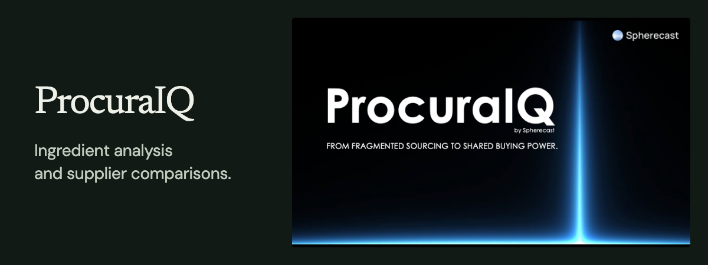
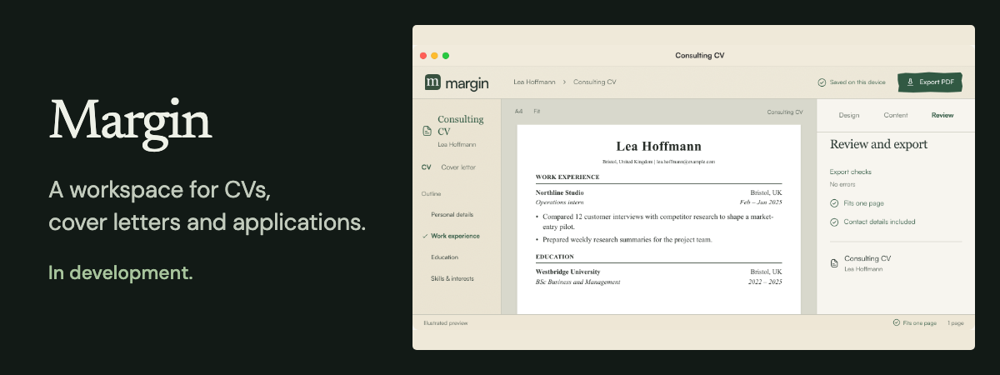
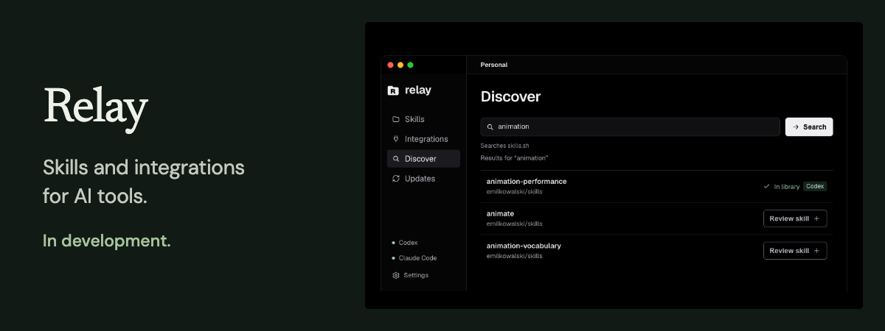

I'm a management student at the University of Mannheim. I like figuring out how businesses work and building things with AI.

[Website](https://melvin.ai.studio/) &nbsp;&nbsp; [LinkedIn](https://www.linkedin.com/in/melvinfriedrichsen/)

## Projects

## In the works

These projects are in development. Select an image to see its animated, illustrated preview.

