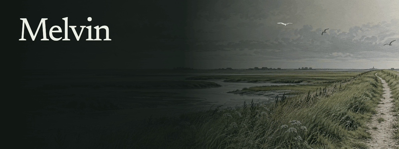
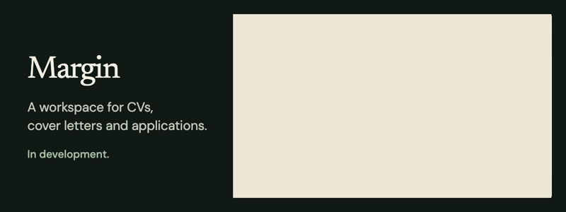
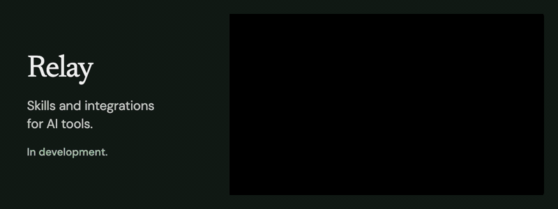
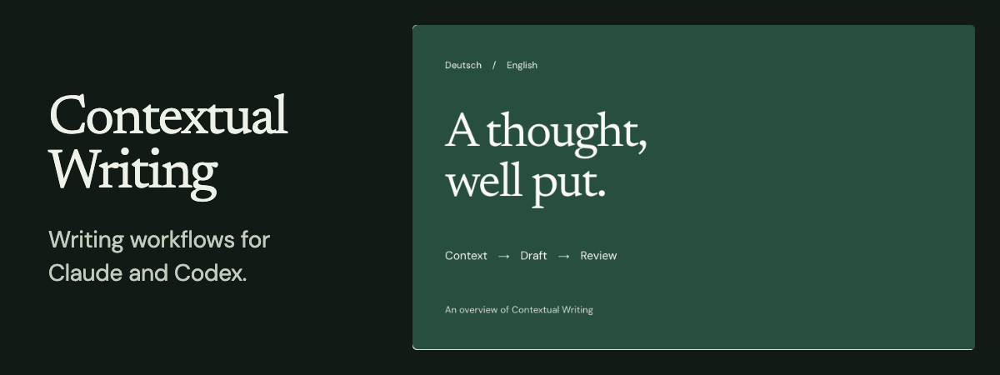
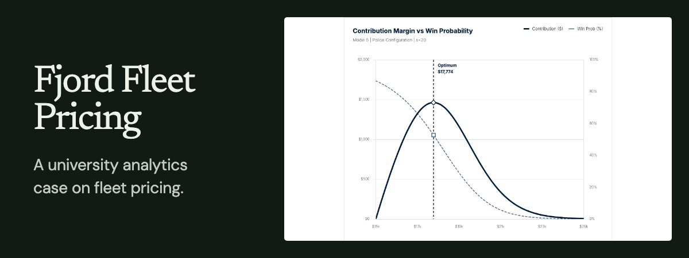
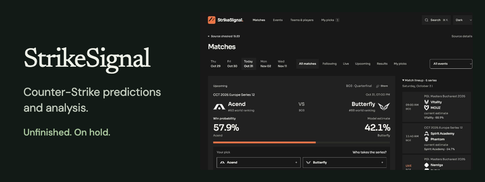
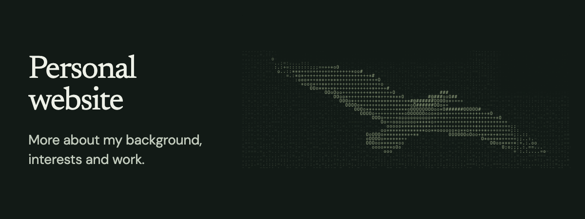

<a href="https://melvin.ai.studio/">
  <picture><source media="(prefers-reduced-motion: reduce)" srcset="https://raw.githubusercontent.com/optimelv/optimelv/main/assets/coast-still.png" /></picture>
</a>

I'm a management student at the University of Mannheim. I like figuring out how businesses work and building things with AI.

[Website](https://melvin.ai.studio/) &nbsp;&nbsp; [LinkedIn](https://www.linkedin.com/in/melvinfriedrichsen/)

## Projects

Margin and Relay are in development. The animations are illustrated previews; click through for more.

<a href="https://github.com/mferuscomelo/procura-iq"><picture><source media="(max-width: 600px)" srcset="https://raw.githubusercontent.com/optimelv/optimelv/main/assets/projects/procuraiq-mobile-v2.png" /></picture></a>
<a href="https://melvin.ai.studio/in-the-works#margin"><picture><source media="(prefers-reduced-motion: reduce) and (max-width: 600px)" srcset="https://raw.githubusercontent.com/optimelv/optimelv/main/assets/projects/margin-mobile.png" /><source media="(prefers-reduced-motion: reduce)" srcset="https://raw.githubusercontent.com/optimelv/optimelv/main/assets/projects/margin.png" /><source media="(max-width: 600px)" srcset="https://raw.githubusercontent.com/optimelv/optimelv/main/assets/projects/margin-mobile-demo-v1.gif" /></picture></a>
<a href="https://melvin.ai.studio/in-the-works#relay"><picture><source media="(prefers-reduced-motion: reduce) and (max-width: 600px)" srcset="https://raw.githubusercontent.com/optimelv/optimelv/main/assets/projects/relay-mobile.png" /><source media="(prefers-reduced-motion: reduce)" srcset="https://raw.githubusercontent.com/optimelv/optimelv/main/assets/projects/relay.png" /><source media="(max-width: 600px)" srcset="https://raw.githubusercontent.com/optimelv/optimelv/main/assets/projects/relay-mobile-demo-v1.gif" /></picture></a>

## More projects

<a href="https://github.com/optimelv/contextual-writing-skill"><picture><source media="(max-width: 600px)" srcset="https://raw.githubusercontent.com/optimelv/optimelv/main/assets/projects/contextual-writing-mobile.png" /></picture></a>
<a href="https://github.com/optimelv/fjord-fleet-pricing"><picture><source media="(max-width: 600px)" srcset="https://raw.githubusercontent.com/optimelv/optimelv/main/assets/projects/fjord-fleet-mobile.png" /></picture></a>
<a href="https://github.com/optimelv/cs2-predictor"><picture><source media="(max-width: 600px)" srcset="https://raw.githubusercontent.com/optimelv/optimelv/main/assets/projects/strikesignal-mobile.png" /></picture></a>
<a href="https://melvin.ai.studio/"><picture><source media="(max-width: 600px)" srcset="https://raw.githubusercontent.com/optimelv/optimelv/main/assets/projects/personal-website-mobile-v2.png" /></picture></a>
