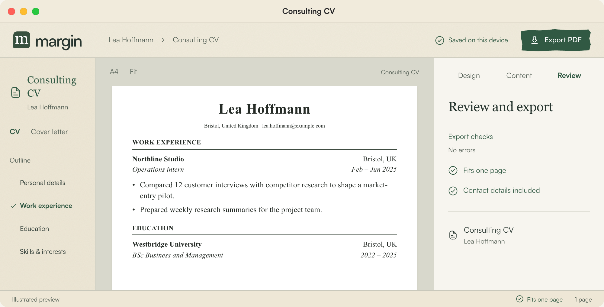
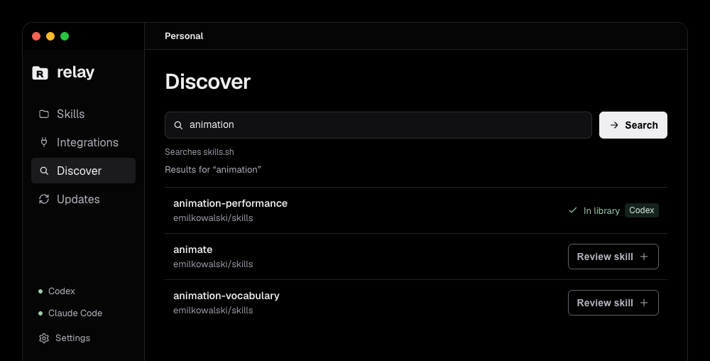

I'm a management student at the University of Mannheim. I like figuring out how businesses work and building things with AI.

[Website](https://melvin.ai.studio/) &nbsp;&nbsp; [LinkedIn](https://www.linkedin.com/in/melvinfriedrichsen/)

## Projects

[**ProcuraIQ**](https://github.com/mferuscomelo/procura-iq)  
AI-assisted ingredient analysis and supplier comparisons.

[**Contextual Writing**](https://github.com/optimelv/contextual-writing-skill)  
German and English writing workflows for Claude and Codex.

[**Fjord Fleet Pricing**](https://fjord-fleet-pricing.vercel.app/)  
An interactive pricing and analytics case for fleet vehicles. [View the code](https://github.com/optimelv/fjord-fleet-pricing).

[**StrikeSignal**](https://melvin.ai.studio/projects/strikesignal)  
Counter-Strike match predictions and analysis. Unfinished, with development currently on hold. [View the code](https://github.com/optimelv/cs2-predictor).

[**Personal website**](https://melvin.ai.studio/)  
More about my background, interests and work.

## In the works

Two projects in development. The images link to animated, illustrated previews.

[**Margin**](https://melvin.ai.studio/in-the-works#margin)  
A workspace for CVs, cover letters and application documents.

[**Relay**](https://melvin.ai.studio/in-the-works#relay)  
A desktop hub for managing skills and integrations across AI tools.

